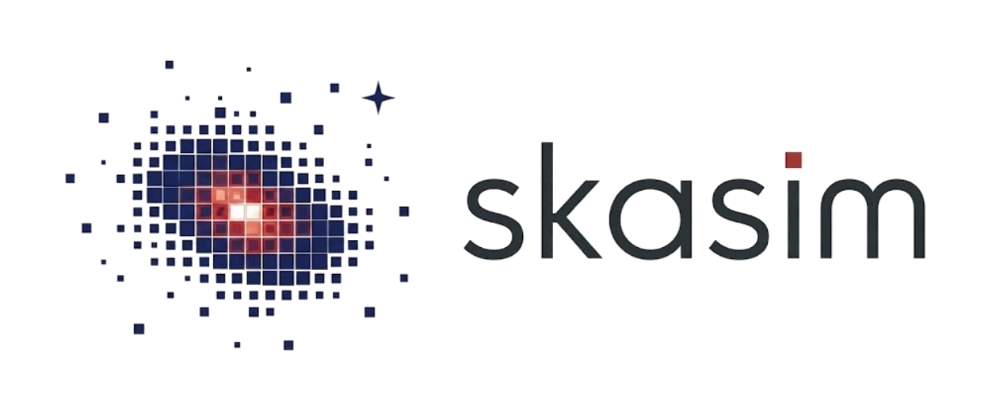

<p align="center">
  
</p>

# skasim — Spanish SRC SKA Simulator

[](https://www.python.org/downloads/)
[](https://github.com/espsrc/skasim)
[](https://espsrc.github.io/skasim/)

**skasim** is a Python package for creating synthetic radio-interferometric observations of the SKA (Square Kilometre Array). It bridges user-supplied sky models and simulated imaging data products, supporting feasibility studies, definition of science cases and pipeline validation for the SKA community.

Born in the context of the CSIC4SKA project at IAA-CSIC, skasim wraps [Karabo](https://i4ds.github.io/Karabo-Pipeline/), OSKAR, and optionally WSClean behind a unified configuration model and a single CLI entrypoint.

```
Sky Model ──> OSKAR simulation ──> visibilities.MS ──> Image (OSKAR / WSClean)
```

---

## Key Features

- **Pydantic-validated configuration** — `SimConfig`, `ObsConfig`, `ImgConfig` catch parameter errors and reject deprecated 0.1 fields
- **Typed sky-model API** — component catalogs, continuum I+α maps, CASA Taylor-term images, static Stokes-I maps, and FITS spectral-line cubes
- **Multi-imaging passes** — run several imager/tag combinations from a single visibility set
- **Two imaging pathways** — fast dirty imaging via OSKAR, or cleaned imaging via the external WSClean binary
- **Run records** — every run writes a structured manifest and an always-on weblog, including failed runs

---

## Quick Start

```bash
# Clone the repository
git clone https://github.com/espsrc/skasim.git
cd skasim

# Install after resolving compatible dependencies in a Karabo environment
pip install --no-deps -e .

# Run a small named-catalog simulation with WSClean imaging
skasim --output-dir smoke_mightee_wsclean \
  --telescope MeerKAT \
  --observation-time 60 \
  --frequency-mhz 1300 \
  --pixels 512 \
  --catalog MIGHTEE \
  --imager wsclean \
  --clean-iterations 100
```

See the [full installation guide](docs/installation.rst) and the [user guide](docs/guide.rst) for detailed environment setup and configuration options.

---

## Documentation

The full rendered documentation lives at **[espsrc.github.io/skasim](https://espsrc.github.io/skasim/)**.
Realistic science demonstrations are collected in the public **science-case gallery** at https://espsrc.github.io/skasim-gallery/.

---

## Dependencies

- **Python** ≥ 3.10 (and < 3.13)
- **[Karabo pipeline](https://github.com/i4ds/Karabo-Pipeline)** (Conda-installable, includes OSKAR and ska-sdp-datamodels)
- **OSKAR** simulation backend (included in Karabo)
- **WSClean** (optional) — for cleaned imaging
- **python-casacore** / **CASA** (required by the relevant image-model paths) — for image preparation and measurement-set updates

Karabo 0.36 drops the RASCIL dependency; see Karabo's [migration guide](https://i4ds.github.io/Karabo-Pipeline/migration_rascil.html). This does not change skasim's runtime compatibility baseline: the cluster runtime remains verified on Python 3.9, while the package metadata targets Python 3.10–3.12.

---

## CLI Reference

```text
skasim [sky-model options] [observation options] [imaging options]
skasim --config PATH [--output-dir PATH] [--overwrite]

Key options:
  --config PATH               JSON configuration file
  --model PATH                Sky model file: FITS, JSON, pickle, or Karabo model
  --fits-image PATH           2D continuum FITS image
  --catalog NAME              Built-in catalog: MIGHTEE, GLEAM, or SKAMid
  --continuum-stokes-i PATH   Continuum image-model Stokes I FITS
  --continuum-alpha PATH      Continuum image-model spectral-index FITS
  --reference-frequency-hz N  Reference frequency for continuum image model
  --flux-density Jy...        Generated source Stokes I flux densities
  --stokes-q Jy...            Generated source Stokes Q values
  --stokes-u Jy...            Generated source Stokes U values
  --stokes-v Jy...            Generated source Stokes V values
  --telescope NAME            Telescope name (default: SKA1MID)
  --telescope-version NAME    Array-assembly version (e.g. AA4, AA*)
  --show-telescopes           List available telescopes/versions and exit
  --frequency-mhz MHz         Central observing frequency
  --bandwidth-mhz MHz         Bandwidth
  --n-channels N              Number of channels
  --channel-width-mhz MHz     Channel width
  --observation-time SECONDS  Observation duration
  --center SEXAGESIMAL        Field centre, e.g. "10h01m35.1s 2d41m41s"
  --output-dir PATH           Exact output directory name
  --imager NAME               oskar-dirty (default) or wsclean
  --wsclean-command CMD       WSClean command or container invocation
  --pixels N                  Image size in pixels
  --fov ANGLE                 Field of view, e.g. 1deg
  --robust N                  Briggs robustness (default: 0.0)
  --clean-iterations N        WSClean CLEAN iterations
  --no-uv-coverage            Skip shadeMS UV-coverage plot
  --shadems-command CMD       shadeMS command/path
  --uv-coverage-canvas-size N Square canvas size for UV-coverage plot
  --rms                       Enable simple noise model
  --rms-value JY              RMS noise level (simple model)
  --rms-sigma N               RMS sigma multiplier (default: 3.0)
  --noise-rms-start JY        OSKAR station noise RMS start
  --noise-rms-end JY          OSKAR station noise RMS end
  --flux-scale N              Scale file-backed Stokes I flux density
  --column-mapping INDICES    Comma-separated FITS catalog column indices
  --overwrite                 Replace an existing output directory
```

Run `skasim --help` for the complete reference, or check the full API documentation.

Use `--config` for multiple model entries, multiple imaging passes, and image-model types without dedicated CLI flags. Content arguments cannot be combined with `--config`; `--output-dir` and `--overwrite` can override its output settings.

Spectral-line inputs use a `models` entry such as `{"type": "spectral_cube", "cube": "line_cube.fits"}` in the JSON configuration, then run `skasim --config simulation.json`. These Stokes-I FITS cubes use RA, Dec, and frequency axes; the FITS header defines the spectral grid. The observed channel centres must lie within the cube's frequency extent, and its spatial geometry must match the imaging configuration. Injection uses WSClean prediction.

Removed or renamed 0.1 options such as `--I`, `--stokes-i`,
`--fits`, `--json`, `--json-fg`, `--freq`, `--seconds`, `--prefix`, `--niter`,
`--scale-I`, `--cleaning`, numeric catalog IDs, and the Python config fields
`I`, `Q`, `U`, `V`, `cleaning`, `source_names`, `ref_freq_hz`, `json_fg`,
`output_prefix`, `niter`, `scale_I`, and `ImgConfig.algorithm` fail
intentionally in 0.2+.

---

## Project Structure

```
src/skasim/
├── __init__.py              # Public API: SimConfig, ObsConfig, ImgConfig
├── cli.py                   # argparse CLI
├── config.py                # Pydantic models: SimConfig, ObsConfig, ImgConfig, ModelEntry
├── pipeline.py              # Orchestrator: sky → simulation → imaging
├── sky.py                   # Source, SkyModel, catalog loaders
├── imaging.py               # Dirty (OSKAR) / cleaned (WSClean) imaging
├── image_geometry.py        # Derive and validate imaging geometry
├── loaders/
│   ├── __init__.py          # Loader exports
│   ├── fits_catalogue.py    # FITS component-catalog loader
│   ├── fits_image.py        # FITS image-to-component loader
│   ├── wsclean_predict.py   # Predict image-model visibilities with WSClean
│   └── image_models/
│       ├── __init__.py      # Public image-model façade and injection orchestration
│       ├── fits_io.py       # FITS metadata, geometry and model validation
│       ├── casa_interop.py  # CASA preparation and spectral resampling
│       └── previews.py      # Image-model and spectral-cube previews
├── manifest.py              # RunManifest, RunContext, milestone tracking
├── runtime.py               # Lazy Karabo/OSKAR/CASACore importers
├── weblog.py                # HTML report renderer
├── templates/
│   └── weblog.html.j2       # Weblog template
└── utils.py                 # Constants, helpers, logger init, shadeMS wrappers
```

---

## References

1. **Karabo Pipeline** — I4DS framework for radio-astronomy simulations. [Documentation](https://i4ds.github.io/Karabo-Pipeline/) | [GitHub](https://github.com/i4ds/Karabo-Pipeline)
2. **OSKAR** — Oxford SKA Simulator. [Documentation](https://ska-telescope.gitlab.io/sim/oskar/) | [GitLab](https://gitlab.com/ska-telescope/sim/oskar)
3. **WSClean** — Widefield radio interferometric imager. [GitLab](https://gitlab.com/aroffringa/wsclean)
4. **ska-sdp-datamodels** — SKA Science Data Processor data models. [Repository](https://gitlab.com/ska-telescope/sdp/ska-sdp-datamodels)
